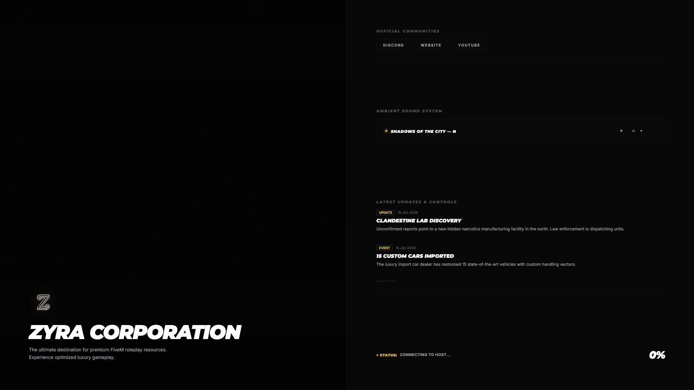
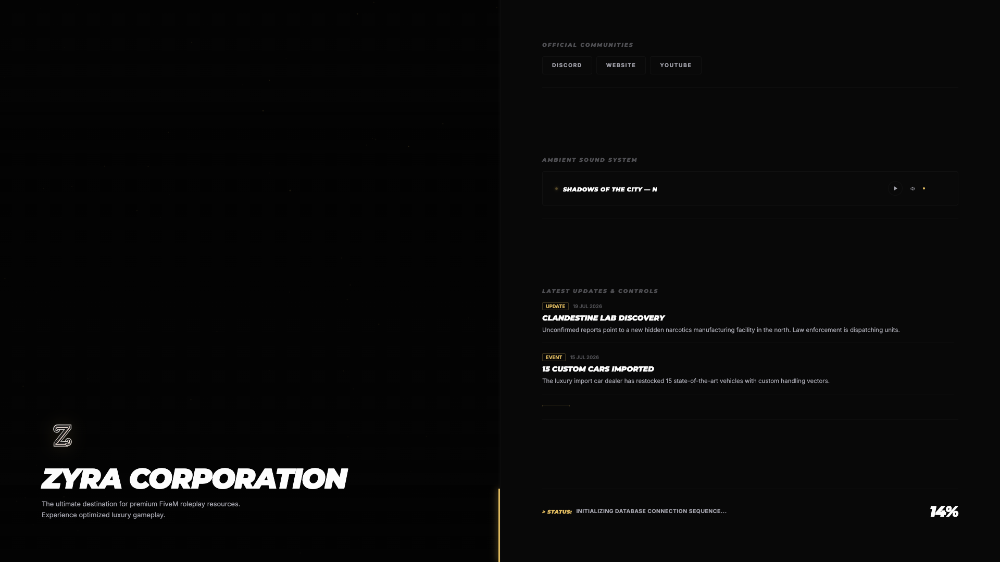

# 📰 Zyra Loading Screen 6 - Editorial Split-Screen Edition

Welcome to **Zyra-Loading-Screen-6**, a dynamic split-screen loading screen resource by **Zyra Store**. Styled like an urban sport magazine with bold italic Montserrat typography and side-by-side media showcase.

---

## 📸 Preview Showcase





---

## 🛠️ Key Features

- **Editorial Split-Screen Design:** High-contrast two-column layout with heavy Montserrat bold italic typography.
- **Side-by-Side Media Showcase:** Dedicated space for server gallery images, feature spotlights, and video.
- **Ambient Sound System:** Streaming audio player with playlist selector and volume slider.
- **Community Highlight Badges:** Interactive cards for community lore, server rules, and social media.

---

## 📦 Installation Instructions

1. **Copy the Resource:**
   Place `Zyra-Loading-Screen-6` inside your `resources` folder:
   `resources/[zyra]/Zyra-Loading-Screen-6`

2. **Add to `server.cfg`:**
   Insert the following line in `server.cfg`:
   ```cfg
   ensure Zyra-Loading-Screen-6
   ```

3. **Launch Resource:**
   Restart your FiveM server or run:
   ```cmd
   refresh
   ensure Zyra-Loading-Screen-6
   ```

---

## ⚙️ Configuration Guide (`config.js`)

- **Hero Typography:** Customize primary server name and claim text.
- **Soundtrack Setup:** Configure background `.mp3` playlist files and defaults.
- **Social Badges:** Set custom URLs for Discord, Store, and Twitch.

---

## ⛔ License & Commercial Restrictions

> [!CAUTION]
> **RESALE IS STRICTLY PROHIBITED (OPEN CODE RESOURCE)**
> This resource is released as **Open Code / Open Source**. Selling, re-selling, monetizing, or offering this resource on Tebex, Discord, or any commercial platform is **STRICTLY PROHIBITED**. You are permitted to modify and use this code freely on your personal FiveM servers, but commercial distribution is prohibited by **Zyra Store**.

---

## 💎 Credits & Support

Developed with ❤️ by **Zyra Store**.  
All rights reserved.
